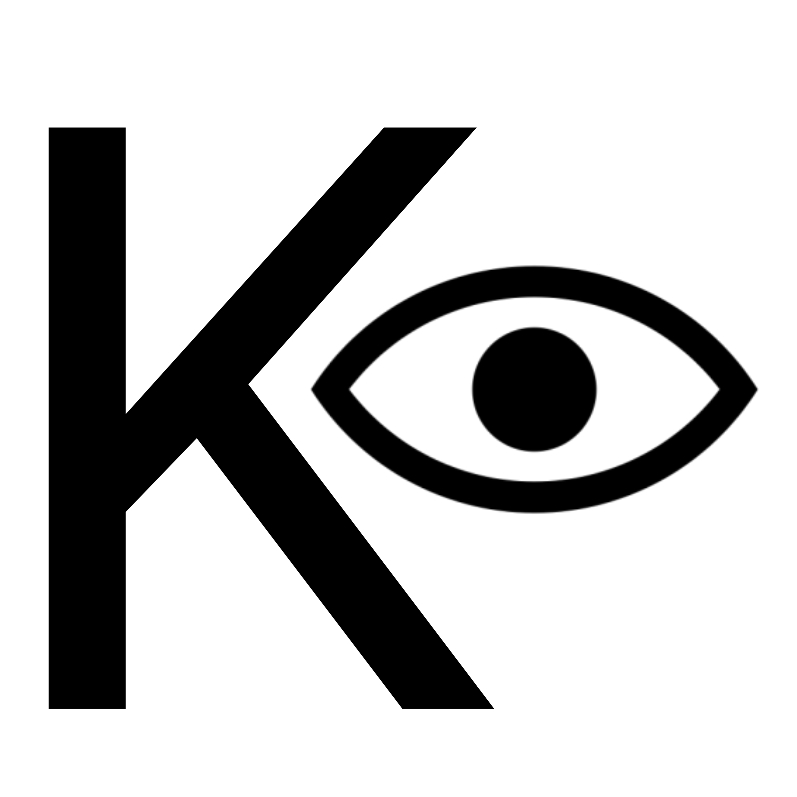

# camKapture v2.0 - Professional Webcam Application

<p align="center">
  
</p>

<p align="center">
  <strong>A production-grade desktop application for webcam capture with professional effects and intuitive GUI</strong>
</p>

<p align="center">
  <a href="#features">Features</a> •
  <a href="#installation">Installation</a> •
  <a href="#usage">Usage</a> •
  <a href="#effects">Effects</a> •
  <a href="#development">Development</a>
</p>

---

## 🎯 Features

### Core Capabilities

- ✨ **Modern GUI** - Professional Qt-based interface with live preview
- 📸 **Photo Capture** - High-quality image capture with effects
- 🎥 **Video Recording** - Record videos with pause/resume functionality
- 🎨 **40+ Effects** - Professional image effects and filters
- ⚡ **Burst Mode** - Rapid continuous capture
- ⏱️ **Timer Capture** - Countdown timer for selfies
- 🎛️ **Real-time Preview** - See effects before capturing

### Professional Features

- 🔧 **Configurable Settings** - Resolution, FPS, output directories
- 📁 **Smart Organization** - Automatic file management with timestamps
- 🎚️ **Effect Parameters** - Adjustable intensity and settings
- 🔍 **Camera Selection** - Multiple camera support
- 📊 **Resolution Presets** - 720p, 1080p, 4K support
- 💾 **Persistent Configuration** - Save your preferences
- 📝 **Comprehensive Logging** - Debug and error tracking

### Technical Excellence

- 🏗️ **Modular Architecture** - Clean, maintainable code structure
- 🧪 **Unit Tests** - Comprehensive test coverage
- 🔒 **Error Handling** - Robust error management
- 📦 **Easy Distribution** - Installable package with setup.py
- 🌐 **Cross-platform** - Linux, macOS, Windows support

---

## 🚀 Installation

### Prerequisites

- Python 3.7 or higher
- Webcam/camera device

### Quick Install

#### 1. Clone the repository

```bash
git clone https://github.com/manojuppala/camKapture.git
cd camKapture
```

#### 2. Create virtual environment

**Linux and macOS:**

```bash
python3 -m venv venv
source venv/bin/activate
```

**Windows:**

```bash
python -m venv venv
.\venv\Scripts\activate
```

#### 3. Install dependencies

```bash
pip install -r requirements.txt
```

#### 4. Run the application

```bash
python main.py
```

### Install as Package (Optional)

```bash
pip install -e .
```

Then run from anywhere:

```bash
camkapture
```

---

## 💡 Usage

### GUI Interface

The application features a modern, user-friendly interface:

1. **Camera Preview** - Live camera feed on the left
2. **Controls Panel** - Capture buttons and mode selection
3. **Effects Panel** - Browse and apply effects with adjustable parameters
4. **Settings** - Configure camera, resolution, and output directories

### Quick Actions

- **Capture Photo**: Click "📷 Capture Photo" button
- **Record Video**: Click "▶ Start Recording", then "⏹ Stop Recording"
- **Apply Effect**: Select from effects dropdown, adjust parameters, click "Apply"
- **Change Settings**: Menu → Settings → Preferences

---

## 🎨 Effects (40+ Total!)

### Basic Effects (8)

- **Flip Vertical/Horizontal** - Mirror and flip transformations
- **Grayscale** - Black and white conversion
- **Sepia** - Classic vintage brown tone
- **Black & White** - High contrast B&W with threshold
- **Invert** - Negative/inverted colors
- **Posterize** - Reduce colors for poster effect
- **Solarize** - Partial inversion based on threshold

### Artistic Effects (14)

- **Cartoonify** - Cartoon-style rendering with edge detection
- **Sketch** - Pencil sketch effect (color or grayscale)
- **Oil Painting** - Oil painting simulation
- **Vintage** - Retro photo with sepia and grain
- **Vignette** - Darkened corners effect
- **Pixelate** - Pixel art/mosaic effect
- **HDR** - High dynamic range enhancement
- **Warm Glow** - Soft warm tone with glow
- **Cool Tone** - Cyan/blue cool tone
- **Film Grain** - Add analog film grain noise
- **Cross Process** - Cross-processed film look
- **Infrared** - Simulated infrared photography
- **Bleach Bypass** - Desaturated, high-contrast film look
- **Mirror** - Kaleidoscope mirror effects

### Adjustments (11)

- **Brightness** - Lighten or darken (-100 to +100)
- **Contrast** - Adjust contrast (0.5 to 3.0)
- **Saturation** - Color intensity control
- **Blur** - Smooth blur effect
- **Gaussian Blur** - Advanced blur with sigma control
- **Sharpen** - Image sharpening with convolution
- **Temperature** - Warm/cool color adjustment
- **Denoise** - Remove image noise
- **Motion Blur** - Directional blur effect
- **Auto Level** - Automatic histogram normalization
- **Gamma** - Gamma correction

### Edge Detection (5)

- **Edge Detection** - Canny edge detector
- **Sobel** - Gradient-based edge detection
- **Emboss** - 3D embossed effect
- **Laplacian** - Laplacian edge detection
- **Outline** - Clean outline on white background

### Color Effects (6)

- **Negative** - Color negative film effect
- **Duo Tone** - Two-color gradient mapping
- **Color Pop** - Isolate one color, desaturate rest
- **LUT** - Look-Up Table color grading (warm/cool/contrast)
- **Channel Swap** - Swap RGB channels
- **Color Balance** - Adjust individual RGB channels

---

## 📁 Project Structure

```
camKapture/
├── camkapture/              # Main package
│   ├── core/               # Core functionality
│   │   ├── camera.py       # Camera management
│   │   └── capture.py      # Capture operations
│   ├── effects/            # Image effects
│   │   ├── base.py         # Base effect class
│   │   ├── basic.py        # Basic effects
│   │   ├── artistic.py     # Artistic effects
│   │   ├── adjustments.py  # Image adjustments
│   │   └── edge.py         # Edge detection
│   ├── gui/                # GUI components
│   │   └── qt_main_window.py  # Qt-based main window
│   └── utils/              # Utilities
│       ├── config.py       # Configuration management
│       └── logger.py       # Logging setup
├── tests/                  # Unit tests
├── main.py                 # Application entry point
├── setup.py                # Package setup
└── requirements.txt        # Dependencies
```

---

## 🧪 Development

### Running Tests

```bash
# Run all tests
python -m pytest tests/

# Run specific test file
python -m pytest tests/test_effects.py

# Run with coverage
python -m pytest --cov=camkapture tests/
```

### Code Structure

The codebase follows a modular architecture:

- **Core** (`camkapture/core/`) - Camera and capture management
- **Effects** (`camkapture/effects/`) - Image processing effects
- **GUI** (`camkapture/gui/`) - User interface components
- **Utils** (`camkapture/utils/`) - Configuration and logging

### Adding New Effects

1. Create effect class in appropriate module (e.g., `effects/artistic.py`)
2. Inherit from `Effect` base class
3. Implement `apply(frame)` method
4. Add to exports in `effects/__init__.py`
5. Register in `gui/effects_panel.py`

Example:

```python
from .base import Effect

class MyEffect(Effect):
    def __init__(self, param=1.0):
        super().__init__("My Effect", param=param)

    def apply(self, frame):
        # Process frame
        return processed_frame
```

### Configuration

Configuration is stored in `~/.camkapture/config.json`:

- Camera settings (device, resolution, FPS)
- Output directories
- UI preferences
- Capture settings

Logs are stored in `~/.camkapture/logs/`

---

## 🤝 Contributing

Contributions are welcome! Please feel free to submit a Pull Request.

1. Fork the repository
2. Create your feature branch (`git checkout -b feature/AmazingFeature`)
3. Commit your changes (`git commit -m 'Add some AmazingFeature'`)
4. Push to the branch (`git push origin feature/AmazingFeature`)
5. Open a Pull Request

---

## 📋 Requirements

- Python 3.7+
- opencv-python >= 4.5.0
- numpy >= 1.19.0
- Pillow >= 8.0.0

---

## 🐛 Known Issues

- Oil painting effect may not work on all OpenCV builds (falls back to bilateral filter)
- Some effects may be CPU-intensive on high resolutions

---

## 🗺️ Roadmap

- [ ] Face detection and tracking
- [ ] Green screen / chroma key
- [ ] Multiple effect stacking
- [ ] Custom effect presets
- [ ] Video format options (H.264, AVI, etc.)
- [ ] Snapshot history viewer
- [ ] Social media export

---

## 📄 License

camKapture is free software licensed under the **GNU General Public License v3.0**.

```
camKapture - Professional Webcam Application
Copyright (C) 2024 camKapture Contributors

This program is free software: you can redistribute it and/or modify
it under the terms of the GNU General Public License as published by
the Free Software Foundation, either version 3 of the License, or
(at your option) any later version.

This program is distributed in the hope that it will be useful,
but WITHOUT ANY WARRANTY; without even the implied warranty of
MERCHANTABILITY or FITNESS FOR A PARTICULAR PURPOSE.  See the
GNU General Public License for more details.

You should have received a copy of the GNU General Public License
along with this program. If not, see <https://www.gnu.org/licenses/>.
```

[](https://www.gnu.org/licenses/gpl-3.0)

---

## 👏 Acknowledgments

- Built with [OpenCV](https://opencv.org/)
- GUI powered by [PySide6 (Qt for Python)](https://doc.qt.io/qtforpython/)
- Image processing with [NumPy](https://numpy.org/)

---

<p align="center">
  Made with ❤️ by the camKapture community
</p>
